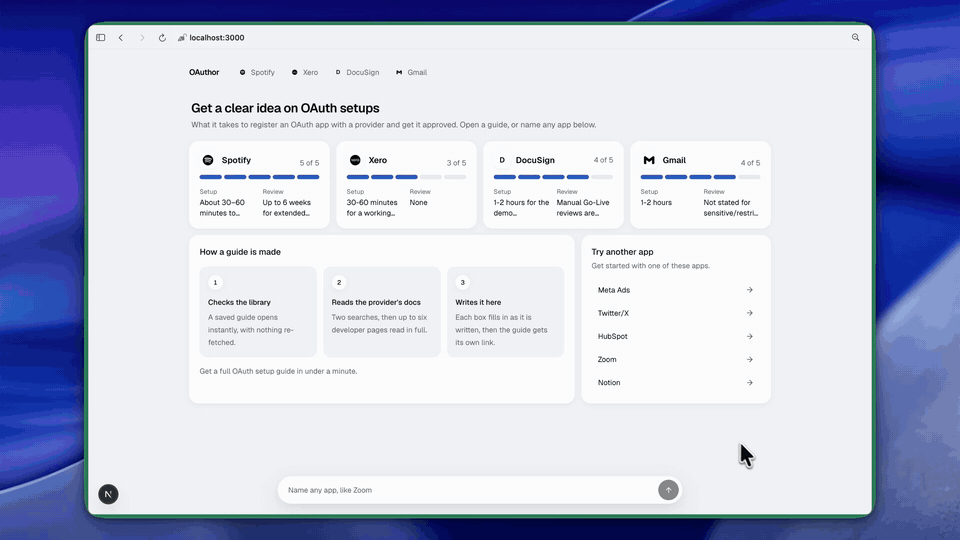

<div align="center">

<h1>OAuthor</h1>

Know if your OAuth app is an hour or six weeks away.

Built for agent builders on Composio.

[Demo](#demo) · [How it works](#how-it-works) · [Run it](#run-it-locally)

</div>

---

<a href="docs/demo.mp4"></a>

<p align="center"><sub>Click for the full 50-second demo with sound.</sub></p>

Composio provides managed OAuth apps for 124 toolkits. For the other 258, and for any app you take to production under your own name, you have to register an OAuth app with the provider yourself, and sometimes wait weeks for it to be approved.

OAuthor tells you what you're in for. Type any app's name, an agent reads the provider's developer docs, and a guide fills in on the page: how hard it is, how long it takes, what you need first, which steps an AI agent can do for you, and where people get stuck.

## Demo

Five guides are in the library, picked to cover the whole range.

| App | Difficulty | What decides it |
|---|---|---|
| Notion | 1 of 5 | A public connection works without review. Review only applies if you list it on the Notion Marketplace. |
| Xero | 3 of 5 | Self-serve, but the free tier caps you at 5 connected organisations. Past that you need a paid tier and App Partner certification. |
| DocuSign | 4 of 5 | Free developer sandbox, then a manual Go-Live review before production. |
| Gmail | 4 of 5 | Gmail scopes are sensitive or restricted, so they need Google's OAuth verification, and possibly a security assessment. |
| Spotify | 5 of 5 | Development mode allows 5 users. Extended quota is open only to organisations, and review can take up to six weeks. |

Any other app is generated live. Each guide gets its own link (`/?app=notion`) you can send to a teammate.

## How it works

You ask in plain words.

> "How do I get an OAuth app for DocuSign?"

The chat model has three tools and works through them in order.

```
get_guide(slug)      → a saved guide? Open it. Nothing is re-fetched.
research_app(name)   → 2 Firecrawl searches, then up to 6 doc pages read in full
render_guide(guide)  → stream the guide into the page, validate it, save it to Supabase
```

The guide streams in as JSON. Each box on the page fills in the moment its part of the JSON is complete, so you watch the verdict land first and the sources last. The progress row in the chat bubble shows which tool is running.

Plain questions get plain answers. "Why is Xero a 3?" reads the saved guide and answers from it. Each app keeps its own conversation in your browser (IndexedDB). Only the conversation text is stored there; the guide always comes from Supabase.

## The guide

Every guide is the same Zod schema, so the agent returns data, not prose, and every guide renders the same way.

| Field | Answers |
|---|---|
| `difficulty` | How hard is this? 1 to 5, with the reason. |
| `time.setup`, `time.approvalWait` | How long is the hands-on part, and how long do I wait on the provider? |
| `requirements` | Do I qualify? A business entity, a privacy policy URL, a paid plan. |
| `steps[].agentCompatible` | What can I hand off? Steps an agent with browser access could do get an **AI can do this** badge. |
| `issues` | Where do people get stuck? At most 5, each with its fix. |
| `references` | Which pages is this based on? |

The schema lives in [`lib/guide.ts`](lib/guide.ts). The system prompt that fills it is in [`lib/prompt.ts`](lib/prompt.ts).

## How I built it

Mostly with agents, and the real runs changed the design more than the plan did.

- **Spec by interrogation.** I had Claude Code grill me one question at a time until the deliverable was pinned down: who the user is, what the guide must answer, and what to leave out. The decisions are in [`SPEC.md`](SPEC.md).
- **Build by delegation.** A subagent built v0 from the spec. I reviewed its diff, reran its checks myself, and had a second agent remove dead comments.
- **Real runs found the real bugs.** The first Spotify guide said it couldn't read the quota rules. Spotify's sidebar links filled the first 6,000 characters of every page, so the scraper now drops link-only lines before it truncates. Then two of three `render_guide` calls came back as broken JSON, because the model left an object unclosed. [`repairGuideInput`](lib/guide.ts) now fixes that before validation, and the smoke test replays the exact failure.
- **Design by measurement.** The UI was restyled with a design skill that deals a style, then checks the result in a real browser at three widths for contrast, empty space, and cards that don't line up.

## What's solid, and what isn't

| | |
|---|---|
| **Tested** | Real end-to-end runs for all five guides: docs fetched, guide streamed, validated and saved. Saved guides survive schema changes, because old rows are migrated when they're read. The smoke test covers the schema, slugs, the JSON repair and the migration. |
| **Backed by sources** | Every guide is extracted only from the pages `research_app` returned, and lists them under Sources. |
| **Uncertain** | Difficulty, time and `agentCompatible` are the model's judgement from those docs. No agent has tried a real setup yet. Some answers are wrong in ways only a careful read catches: Xero says "No review step" although App Partner certification is a review. |

## Limits and next

- **No agent attempts the setup yet.** The next step is a browser agent working through free consoles (Spotify, Notion, Google Cloud) and recording where it gets stuck, so the AI badges rest on evidence.
- **Firecrawl's free plan rate-limits parallel runs.** Three guides at once returned `429` errors, and research has no retry yet.
- **The Composio route is built but unproven.** Firecrawl can run through Composio's tools (leave out `FIRECRAWL_API_KEY`), but every run so far used the direct Firecrawl API.
- **No rate limiting.** Every run spends the owner's OpenRouter and Firecrawl credits.

## Run it locally

You need Node 22+, pnpm, and keys for OpenRouter, Firecrawl and Supabase.

```bash
git clone https://github.com/Roho7/oauthor.git
cd oauthor
pnpm install
cp .env.example .env.local
```

Fill in `.env.local`. Set `FIRECRAWL_API_KEY` to call Firecrawl directly, or `COMPOSIO_API_KEY` to go through Composio. In Supabase, create the `composio.guides` table described in [`SPEC.md`](SPEC.md), and add `composio` under Settings → Data API → Exposed schemas.

```bash
pnpm dev
```

To check the schema and repair logic, run `pnpm tsx scripts/smoke.ts`.

## Tech stack

Next.js 16, Vercel AI SDK with OpenRouter (Claude Sonnet 5.5), Firecrawl, Composio, Supabase, Zod, shadcn/ui, Tailwind.

## Acknowledgments

- **[Composio](https://docs.composio.dev/docs/authentication).** The auth docs this is built on, and the managed OAuth list it starts from.
- **[Firecrawl](https://firecrawl.dev).** Search and scrape for the research step.
- **[Simple Icons](https://simpleicons.org) via [react-icons](https://react-icons.github.io/react-icons/).** The app logos.
